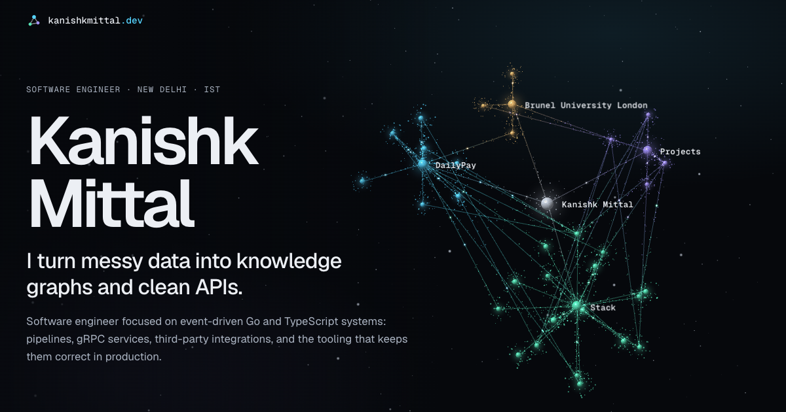

# kanishkmittal.dev

The personal site of Kanishk Mittal, software engineer.

The page sits on top of a 3D knowledge graph of the profile it describes. It opens as a cloud of scattered points, resolves into the graph, and the camera flies from cluster to cluster as you scroll.



## Stack

- [Astro](https://astro.build) builds a fully static site. All content is in the HTML.
- [three.js](https://threejs.org) draws the graph with custom shaders. It loads in its own chunk after the page is usable.
- TypeScript throughout, with [Vitest](https://vitest.dev) for the scene logic.
- nginx serves the build in Docker.

## Run it

You need Node 22.12 or later.

```sh
npm install
npm run dev      # dev server with hot reload, http://localhost:4321
```

| Command           | What it does                                    |
| ----------------- | ----------------------------------------------- |
| `npm run dev`     | Dev server with hot reload                      |
| `npm run build`   | Type-check, then build the site into `dist/`    |
| `npm run preview` | Serve the built `dist/` locally                 |
| `npm run lint`    | Type-check the Astro and TypeScript files       |
| `npm test`        | Run the unit tests                              |

## Run it in Docker

You need Docker with Compose.

```sh
make up      # build the image and start the site, http://localhost:4321
make down    # stop and remove the container and its network
```

`make up PORT=8080` uses another port. `make down` keeps the image, so the next `make up` is quick.

The image is two stages: Node builds the site, then a non-root nginx image serves it. The container's filesystem is read-only. The nginx config is in `config/nginx.conf`.

## Change the content

Almost every word on the page is in one file.

| To change                                | Edit                         |
| ---------------------------------------- | ---------------------------- |
| Text: roles, projects, skills, contact   | `src/data/profile.ts`        |
| Graph nodes and the links between them   | `src/data/graph.ts`          |
| Where the camera rests for each section  | `src/scene/waypoints.ts`     |
| Colours, for the page                    | `src/styles/global.css`      |
| Colours, for the graph                   | `src/scene/palette.ts`       |

The two colour files mirror each other, so change them together.

A node in `graph.ts` needs an `id`, a `label`, a `cluster` and the `section` it scrolls to when clicked. Each cluster has exactly one hub. Every other node is linked to its hub automatically, and `CROSS_EDGES` holds the links between clusters. The tests fail if an edge points at a node that doesn't exist.

A rebuild carries a text change through to the page, the graph labels and the metadata. The one exception is `public/og.png`, the social preview image, which is a screenshot of the hero and has to be retaken by hand.

## How it's laid out

```
src/
  data/         Content and graph data, plus their types
  components/   One Astro component per section
  layouts/      The page shell: head, metadata, theme bootstrap
  pages/        index and 404
  scene/        The 3D graph
  scripts/      Page behaviour: theme, nav, reveals, terminal demo
  styles/       Design tokens and global styles
tests/          Unit tests for the scene logic
config/         nginx config for the Docker image
public/         Favicon, social image, robots.txt, sitemap
```

Inside `scene/`:

| File             | Job                                                                 |
| ---------------- | ------------------------------------------------------------------- |
| `layout.ts`      | Places nodes and the loose points. Pure and deterministic.          |
| `waypoints.ts`   | Maps scroll position to a camera position. Pure.                    |
| `builders.ts`    | Turns the layout into three.js geometry                             |
| `shaders.ts`     | GLSL for points, nodes, edges and pulses                            |
| `graph-scene.ts` | The renderer: intro, camera easing, themes                          |
| `labels.ts`      | Node labels as DOM elements, hidden when they'd sit behind a card   |
| `boot.ts`        | Wires the scene to scroll, pointer, resize and theme events         |

## How the graph works

Every point has two positions: a random one in a cloud, and a settled one on the graph. A single `uProgress` uniform moves all of them from the first to the second in the vertex shader, each with its own delay, so the graph condenses instead of snapping into place.

Nodes are flat points shaded as lit spheres in the fragment shader. Edges draw outward from their source. Pulses are points that travel along edges.

The layout uses a seeded random generator, so the graph looks the same on every visit.

## Themes and fallbacks

- Dark and light themes follow the system setting. The toggle remembers a choice in `localStorage`.
- With reduced motion turned on, the graph appears already formed and nothing animates.
- Without WebGL, the page shows a plain background.
- Without JavaScript, every section is still readable.

## Deploy

`npm run build` writes a static site to `dist/`. Upload that folder to any static host, such as Cloudflare Pages or Netlify, or run the Docker image.

The site URL is set in `astro.config.mjs`. It's used for the canonical link and the social image URL.
